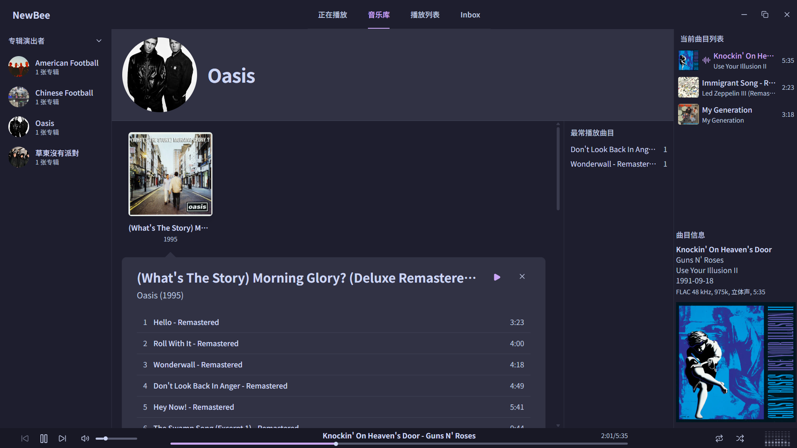
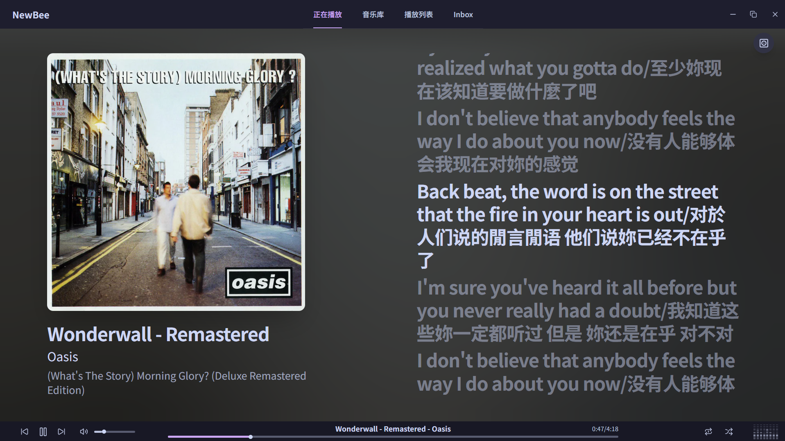
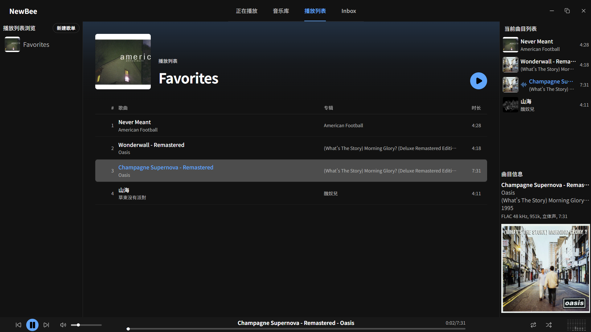

<p align="center">
  
</p>

<h1 align="center">NewBee</h1>

<p align="center">面向本地音乐收藏的桌面播放器，集音乐库管理、播放与标签整理于一体。</p>

## 截图



|                  正在播放                  |                  播放列表                  |
| :----------------------------------------: | :----------------------------------------: |
|  |  |

## 特色

- **本地音乐库**：按艺人、专辑浏览，支持目录扫描、文件导入与文件夹监视。
- **播放列表与 Inbox**：整理收藏、暂存新音乐，通过播放队列安排收听顺序。
- **标签与封面**：编辑音频标签和封面，匹配 MusicBrainz 发行信息。
- **歌词**：同步显示、编辑与在线搜索。
- **响度归一化**：支持 ReplayGain 分析、标签写入与前级增益调节。
- **桌面体验**：亮色与暗色主题、全局快捷键、托盘轻量模式与应用内更新。

> [!WARNING]
> 项目处于早期开发阶段，功能和稳定性仍在完善。编辑标签前请备份原始音乐文件。

## 下载

[下载最新版本](https://github.com/windytiany/NewBee/releases/latest) · Windows x64

## 开发

技术栈：Tauri 2、Vue 3、TypeScript、Rust、SQLite；使用 Bun 管理前端依赖。

环境配置见 [Tauri 前置要求](https://v2.tauri.app/start/prerequisites/)。

```sh
git clone https://github.com/windytiany/NewBee.git
cd NewBee
bun install --frozen-lockfile
bun run desktop:dev # 开发
bun run tauri build --bundles nsis --config '{"bundle":{"createUpdaterArtifacts":false}}' -- --locked # 本地打包，不生成更新签名
```

开发版与安装版使用独立数据目录，但对同一音乐文件的修改仍会相互影响。

<details>
<summary>检查</summary>

```sh
bun run lint
bun run format:check
bun test
bun run build # 前端构建
cargo fmt --manifest-path src-tauri/Cargo.toml -- --check
cargo check --locked --manifest-path src-tauri/Cargo.toml
cargo clippy --locked --manifest-path src-tauri/Cargo.toml --all-targets -- -D warnings
cargo test --locked --manifest-path src-tauri/Cargo.toml
```

</details>

本项目采用 [MIT 许可证](LICENSE)。
